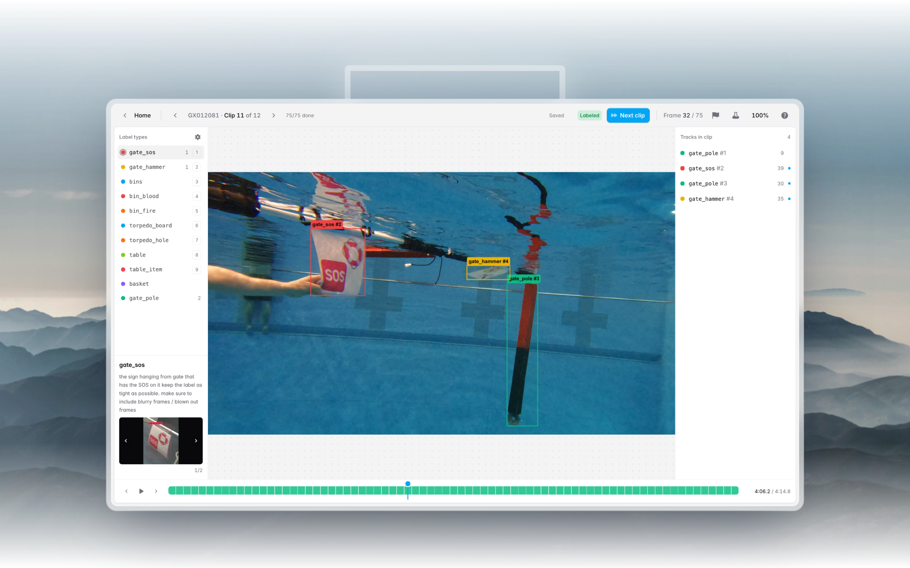

# Krill



Labeling tool for building and validating WAUV's RoboSub YOLO datasets, built to make every labeler as fast as possible.

## Features

- **Keyboard-first labeling.** Label videos using only the keyboard
- **SAM tracking.** Segment Anything (SAM) model integration for automated tracked labeling
- **YOLO pre-labeling.** Train YOLO on verified labels right from the app.
- **Model trials.** Run any model over a clip or a whole video without touching the labels. Compare its boxes against the verified ones, see precision and recall per class, and jump to the frames it got most wrong.
- **Review and accuracy.** Reviewers check labelers' work, and automated checks ensure that labelers are accurate.
- **YOLO exports.** Preview and download a dataset split by video, with eval test videos kept out of training.
- **Admin panel.** Admin panel to manage users, content and monitor server health

## Quick start

```sh
cp .env.example .env
just setup
just dev      # Postgres :5432, MinIO :9000 (console :9001)
just api      # :8080
just web      # :5173
```

Accounts sign up as labelers unless an admin invited them. Sign up, then make yourself an admin:

```sh
just user-role you@example.com admin
```

To run the full stack with the GPU worker, set the passwords and `KRILL_WORKER_TOKEN` in `.env`, then:

```sh
just up
docker compose --env-file .env -f deploy/docker-compose.yml exec api krill user role you@example.com admin
```

The app is served from `:8080`. Browsers load frames straight from MinIO, so `KRILL_S3_PUBLIC_ENDPOINT` must be an address they can reach. After the first admin, roles are changed from the admin panel.

## Contributing

Read [CONTRIBUTING.md](CONTRIBUTING.md).


## License

Copyright © 2026 Wisconsin Autonomous Underwater Vehicles, Camden Rush, and contributors.

Code released under the [MIT License](./LICENSE.md).
