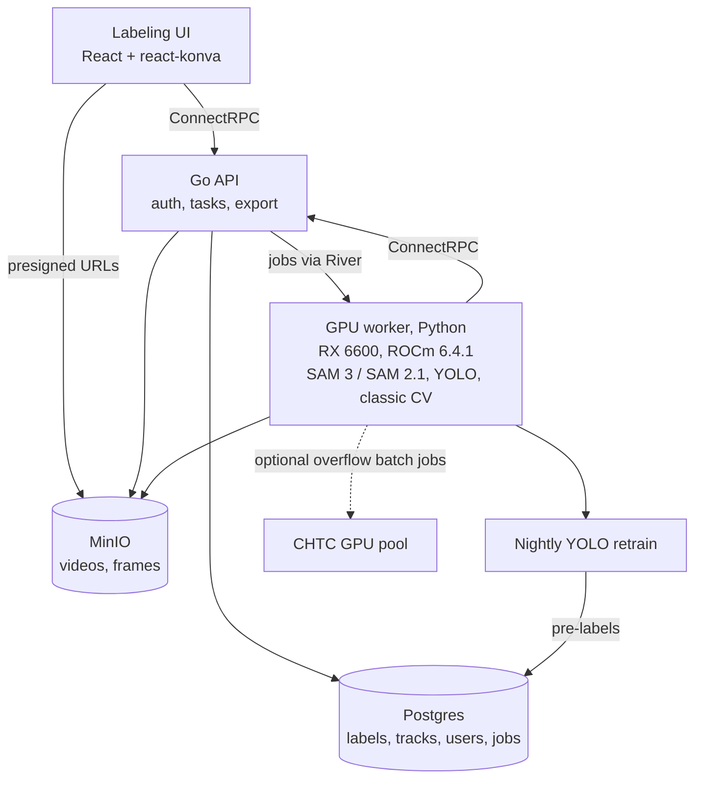

# WAUV Labeling Tool: Design Doc

Status: draft
Owner: Camden Rush
Hosting: on-prem Linux box with an AMD Radeon RX 6600 (working assumption, see Section 5.1)

## 1. Problem

We are training a YOLO model for RoboSub and need bounding boxes and tags for objects in the pool footage we have recorded. Hand-labeling every frame is too slow for a volunteer club, and the result is noisy when many different people label with different habits.

The classes we need:

| Task | What to label | Annotation type |
|---|---|---|
| Gate | Gate frame and the role signs hanging from it | Boxes + role attribute on signs |
| Torpedo | Torpedo board and its holes, bigger vs smaller, and role | Boxes + size and role attributes on holes |
| Bins | Bins and which role's bin it is (image inside) | Boxes + role attribute |
| Table / Octagon | The tabletop, each item and its role, each image on the octagon wall and its role, the basket on the table and its role | Boxes + role attribute (except tabletop) |
| Gripper status | Open, closed, holding something | Frame-level classification |
| Path markers | Marker and its direction (classic CV likely enough at runtime) | Oriented boxes |
| Slalom | Each pipe, white vs red (classic CV + depth likely at runtime) | Boxes + color attribute |

Path markers and slalom may not use YOLO at runtime, but labeling them still gives us ground truth to evaluate the classic CV pipeline against.

## 2. Goals and non-goals

Goals: maximize correct labels per volunteer-hour, keep label quality measurable, let any club member contribute from a browser, and export datasets directly in YOLO format.

Non-goals: training infrastructure beyond a nightly retrain for pre-labeling, general-purpose annotation for other projects, and public or external users.

## 3. Solution overview

The tool is a web app built around one loop: humans label a small amount, models propose labels for the rest, and humans verify. Verifying an existing box is several times faster than drawing one, so the tool's job is to move labelers from drawing to verifying as early as possible while measuring whether the proposals are correct.

Early on, labels come mostly from SAM 3 click-to-track. Once a few hundred verified labels exist, a nightly YOLO retrain pre-labels all unlabeled frames and most work shifts to verify mode. Quality checks run throughout, because each assist also introduces a specific way to produce bad labels (Section 8).

## 4. Features

### 4.1 Click to track
The labeler clicks an object. SAM 3 segments it, the mask becomes a box, and the SAM 3 video tracker propagates it through the clip. If the box drifts, the labeler corrects one frame and re-propagates from there. Image embeddings are computed at ingest so clicks respond immediately.

### 4.2 Exemplar mode
The labeler boxes one instance (one torpedo hole, one bin) and SAM 3's concept prompting finds the other instances in the clip. The labeler deletes false positives. This is most useful for tasks with repeated objects: torpedo holes, bins, octagon images, slalom pipes.

### 4.3 Verify mode
A nightly YOLO retrain on verified labels pre-labels every unlabeled frame. The UI switches to accept, adjust, or reject. Frames are queued by priority: low confidence first, then frames where YOLO and the tracker disagree.

### 4.4 Track-level attributes
Role, size, bin image, and slalom color do not change during a track, so they are assigned once per track and inherited by every frame in it. A crop-grid view shows many crops of one class (for example 30 bins) so a labeler can assign roles with number keys in a fast second pass.

### 4.5 Range labeling for gripper status
Gripper status is a frame-level class, not a box. The labeler sets in and out frames on the timeline and assigns one status (open, closed, holding) to every frame in the range.

### 4.6 Classic CV pre-labelers
Pre-labelers use a plugin interface: any function that takes a frame and returns proposals. The first plugins are HSV thresholds for path markers and red/white slalom pipes. Their proposals go through the same accept/reject flow as YOLO proposals. Path markers are stored as oriented boxes (YOLO-OBB format) so direction is captured in the label.

### 4.7 Frame dedup on export
Tracking produces many near-identical consecutive frames. All frames are labeled, but export applies a frame stride and perceptual-hash dedup so the dataset contains distinct examples instead of duplicates.

### 4.8 Display-only underwater correction
A toggle applies CLAHE and white balance to the frame shown in the UI so labelers can see edges in murky footage. It is never applied to exported images.

### 4.9 Crowdsourcing
Login is Slack OAuth restricted to the WAUV workspace. Work is assigned by clip so two people don't label the same footage. Gold frames with known labels are mixed into each labeler's queue to score accuracy. Low-agreement and flagged frames go to a review queue. A weekly leaderboard is posted to Slack.

### 4.10 Keyboard-first UI
Number keys select class, space accepts, J/K step frames, and E marks a frame as empty. Empty frames are exported as negative examples.

## 5. Architecture

**Ingest.** A video is uploaded, ffmpeg splits it into frames, frames are written to MinIO, the video is chunked into 10 to 20 second clips, and a job computes SAM image embeddings for each clip.

**Click to track.** The UI sends a click (frame, x, y) to the API, which enqueues a propagation job. The worker runs the SAM 3 tracker on that clip and writes proposed boxes with `source = sam` and `status = proposed`. The UI polls or streams results and renders them.

**Verify.** The nightly job trains YOLO on verified labels, runs it on unlabeled frames, and writes proposals with `source = yolo`. The API builds the priority queue from confidence and disagreement.

**Export.** The API flattens type and attributes into YOLO class IDs, applies stride and dedup, splits train/val by video, and writes a versioned dataset to MinIO.

Frame images never go through RPC. The API returns presigned MinIO URLs and the browser fetches frames directly. RPC carries only metadata and annotations.

### 5.1 Compute target: RX 6600

Working assumption: everything (web app, Postgres, MinIO, GPU worker) runs on one Linux box with the club's AMD Radeon RX 6600 (8GB VRAM).

**Software setup.** The RX 6600 (RDNA 2, gfx1032) is not on ROCm's official support list. It runs by setting `HSA_OVERRIDE_GFX_VERSION=10.3.0`, which makes ROCm treat it as a gfx1030. This works on Linux only. ROCm 6.4.3 and later have a known crash with this override on gfx1032, so the worker is pinned to ROCm 6.4.1. The host runs Ubuntu, and the worker container gets `/dev/kfd` and `/dev/dri` passed through with the override set in its environment.

**What runs on the RX 6600.**

| Workload | Model | Expected fit on 8GB |
|---|---|---|
| Single-frame click-to-mask | SAM 3 in FP16 | Expected to fit. Verify in M0. |
| Track propagation | SAM 3 video tracker | Uncertain. Memory grows with frames held per clip. Verify in M0. |
| Track propagation fallback | SAM 2.1 tiny or small | Fits. Same video tracker API as SAM 3, so switching is a config change. |
| Nightly retrain and pre-labeling | YOLO nano or small | Fits at moderate batch sizes. Slower than a 24GB card. |
| Classic CV pre-labelers | OpenCV | CPU. |

**Worker images.** One Dockerfile with a base-image argument builds two images: a ROCm 6.4.1 PyTorch image for the RX 6600, and a CUDA image for NVIDIA targets (CHTC, cloud, or a future donated card). Worker code is identical across both. The worker avoids CUDA-only dependencies such as custom CUDA extensions and NVIDIA-only flash-attn builds, and uses PyTorch's built-in SDPA attention.

**Overflow.** If the RX 6600 is too slow or runs out of memory for bulk SAM 3 passes or larger retrains, those jobs go to CHTC's free GPU pool as batch jobs. CHTC requires a faculty-sponsored account and does not support interactive work, so interactive masking always stays on the local card.

**Limits.** The RX 6600 is enough to develop and run the tool this semester with a small number of simultaneous labelers. It is not expected to handle a full team labeling session with instant click-to-track for everyone. The upgrade path is a sponsored 24GB card (a used RX 7900 XTX or RTX 3090), which swaps in without code changes.

## 6. Stack

| Layer | Choice | Reason |
|---|---|---|
| Frontend | React + TypeScript, Vite, react-konva, Zustand | Most club members know React, so the tool can be handed off. Canvas performance comes from Konva, not the framework. |
| API contract | ConnectRPC (protobuf, Buf) | Typed clients for TS, Go, and Python from one schema. Works from the browser without a proxy. tRPC was ruled out because it requires a TypeScript server. |
| API | Go, sqlc, River | Matches existing Go experience. River keeps the job queue in Postgres, so there is no Redis to run. |
| Database | Postgres | Relational data (videos, clips, frames, tracks, annotations) and the job queue. |
| Object storage | MinIO | S3-compatible, so moving to cloud later is an endpoint change. |
| ML worker | Python, PyTorch on ROCm 6.4.1, SAM 3 (SAM 2.1 fallback) via Hugging Face transformers, Ultralytics YOLO | These models are only available in Python. ROCm version pinned for RX 6600 compatibility (Section 5.1). |
| Ingest | ffmpeg | Frame extraction and clip chunking. |
| Deploy | Docker Compose on one Linux box with the RX 6600 | Simple to run on-prem. A CUDA build of the worker image runs on CHTC or cloud if needed. |

**Frontend rule:** per-frame annotation state lives in a Zustand store and is rendered imperatively in Konva. It never lives in React component state, because re-rendering across hundreds of boxes and frames makes the UI slow.

**Alternatives considered.** Svelte has less boilerplate but is harder to hand off. OpenAPI with codegen is easier to debug with curl but more verbose to maintain. A TypeScript API with tRPC would still need a separate contract for the Python worker.

## 7. Data model

Core tables: `videos`, `clips`, `frames`, `tracks`, `annotations`, `users`, `reviews`, `gold_frames`, `datasets`.

Labels are stored as an object type plus attributes (for example `type = bin`, `role = X`) rather than flat class names. Export flattens these into YOLO class IDs, so the taxonomy can change without relabeling.

Attributes that are constant over a track (role, size, color) are stored on `tracks`. Box geometry is stored per frame on `annotations`.

Every annotation has a `source` (human, sam, yolo, cv) and a `status` (proposed, verified, rejected), plus the user and model version that produced it. This lets us measure how accurate each source is and trace errors back to where they came from.

Train/val splits are made by video, never by frame. Consecutive frames are nearly identical, so a per-frame split puts copies of training images in validation and makes metrics look better than they are.

## 8. Quality risks and mitigations

The assists above increase label volume. Each one also has a specific failure mode, and the mitigations below are part of the first version, not later work.

| Risk | What happens | Mitigation |
|---|---|---|
| Tracker drift | Propagated boxes slide off the object over many frames, especially on low-contrast gate and torpedo edges. Labelers scrubbing quickly miss it. | Automatically flag frames where box area or IoU with the previous frame changes suddenly. Require confirmation of the last frame of every track before it counts as verified. |
| Automation bias | Labelers accept boxes that are slightly wrong because accepting is easy. | Gold frames in every queue measure acceptance accuracy per labeler. Labelers below a threshold have their work routed to review. |
| Hidden misses | Verify mode only shows what YOLO detected. Objects it missed never get proposed, so they never get labeled. | Require an "anything missing?" keypress per frame. Show a sample of frames with pre-labels hidden and compare against the pre-labels to measure recall. |
| Self-confirming model loop | YOLO's consistent errors (for example a reflection detected as a bin) get approved and trained back in. | Keep a hand-labeled test set from videos that are never pre-labeled. Use it only for evaluation. Track per-class precision and recall on it after each retrain. |
| SAM's object boundaries differ from ours | SAM may include shadows and reflections or merge the gate with its markers. Boxes are consistent but consistently wrong for our classes. | Before using SAM at scale on a class, compare 50 SAM boxes against the labeling guideline. Classes where SAM disagrees get a per-class box adjustment or are labeled by hand. |
| Inflated dataset size | Tracking makes frame counts large while the actual variety is small. | Report unique clips, sessions, and conditions per class alongside frame counts. Export dedup (4.7) removes near-duplicates. |
| Inconsistent labeler decisions | Different people make different calls on occlusion, rims, and "holding". | A written labeling guideline with example images per class, linked from the UI. Measure inter-annotator agreement on a shared sample each week. |

The two largest quality factors are outside the tool. The labeling guideline decides whether 15 labelers produce consistent boxes, and the diversity of source video (depth, turbidity, lighting, distance, angle, and competition-site footage) decides how well the model generalizes. The tool reports coverage per condition so gaps are visible.

## 9. Metrics

Throughput: verified labels per labeler-hour, split by source.
Quality: gold-frame accuracy per labeler, inter-annotator agreement, drift-flag rate per class, and recall on hidden-pre-label frames.
Model: per-class precision and recall on the untouched test set after each retrain.
Coverage: unique clips and conditions per class.

## 10. Build vs buy

CVAT is self-hostable and already supports SAM-based tracking, YOLO auto-annotation, and YOLO export. Before building, we pilot CVAT on a few videos. A custom build is justified by the features CVAT handles poorly: verify mode with priority queuing, track-level attributes, gold frames, and Slack-based crowdsourcing. If the pilot shows CVAT covers enough, we use it and build only those pieces around it.

## 11. Milestones

M0: RX 6600 validation. Confirm ROCm 6.4.1 detects the card with the override, SAM 3 click-to-mask fits in 8GB, how many frames SAM 3 propagation handles before running out of memory (fall back to SAM 2.1 if too few), and YOLO-small epoch time.
M1: ingest, frame viewer, manual boxes, track-level attributes, YOLO export with per-video split.
M2: SAM 3 click to track, drift flags, last-frame confirmation, labeling guideline.
M3: Slack login, clip assignment, gold frames, review queue.
M4: nightly retrain, verify mode, hidden-pre-label recall checks, untouched test set.
M5: exemplar mode, classic CV plugins, crop-grid view, range labeling, leaderboard.

## 12. Open questions

Hardware: do the M0 results confirm SAM 3 on the RX 6600, or does interactive propagation need SAM 2.1? Can the faculty advisor sponsor a CHTC account for overflow batch jobs? Is a sponsor willing to donate a 24GB card?
Taxonomy: the full list of roles for gate, torpedo, bins, and table/octagon for this season.
Gripper: which camera shows the gripper, and is its footage in the same videos?
Runtime: will path markers and slalom use YOLO, classic CV, or both?

## 13. Revisit as the system grows

Move the job queue to a dedicated broker if River throughput becomes a bottleneck. Replace the RX 6600 with a 24GB card (used RX 7900 XTX or RTX 3090) once concurrent labelers make click-to-track latency noticeable, or add a rented or credit-funded cloud GPU worker for scheduled labeling sessions. Revisit CVAT if maintaining the custom tool takes more time than labeling.
